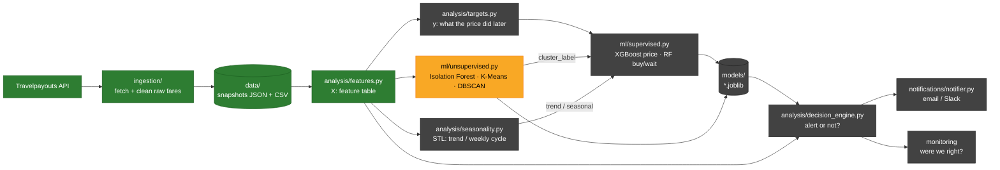
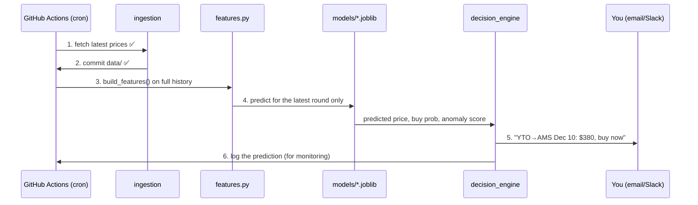
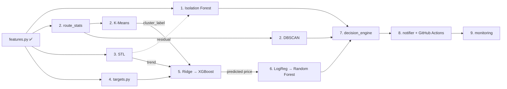

# TODO: what's built, what's left

The goal: every few hours, check flight prices and tell the user **"Buy now"** or **"Wait"**.

## 1. The big picture

🟩 done  ·  🟨 next  ·  ⬜ later

## 2. What happens on every run, once it's all built

GitHub Actions already runs steps 1–2. Steps 3–6 are what's left.

## 3. Checklist

### ✅ Done

- [x] **Ingestion:** `src/ingestion/` (API client, normalizer, multi-route fetch, CSV rebuild)
- [x] **Scheduled collection:** `.github/workflows/fetch_snapshots.yml` runs `scheduler --once` and commits `data/`
- [x] **Cleaning + features:** `src/analysis/features.py` → `build_features()` (X) and `model_matrix()` (tree / linear)

### Build order

Explore each algorithm in `NB.ipynb` first, then move the final choice into its `.py` file.

### 🟨 Step 1: Isolation Forest (`src/ml/unsupervised.py`)

- [ ] One row = one fare. Anomaly score from `price_vs_route_avg_30d`, `price_vs_route_min_30d`, `route_std_7d`, `days_until_departure` → `decision_engine.py` (deal alert)
- [ ] Needs only `features.py`, no `y`

### ⬜ Step 2: route groups (`src/ml/unsupervised.py`)

- [ ] **`route_stats(features)`:** one row = one route (~40): mean, std, min, trend slope. Shared input for the two below.
- [ ] **K-Means** → `cluster_label` (stable / volatile / seasonal) → add to `MODEL_CATEGORIES` in `features.py` as a feature for XGBoost / RF. Pick K with silhouette / elbow; fit on the training period only.
- [ ] **DBSCAN** → outlier flag (−1 = route unlike any other) → `decision_engine.py` (warning)

### ⬜ Step 3: STL (`src/analysis/seasonality.py`)

- [ ] Resample to one price per route per day first; with ~3 weeks it only finds the weekly cycle
- [ ] Trend / seasonal → features for XGBoost; residual → Isolation Forest
- [ ] Least urgent: skipping it for now breaks nothing later

### ⬜ Step 4: the answer column (`src/analysis/targets.py`)

- [ ] `add_targets(features)` adds
  - `future_min_price`: cheapest price of the same trip in the next 7 days (for XGBoost)
  - `buy`: 1 if waiting saves less than 5% (for Random Forest)
  - only rows whose 7-day window is fully observed get a value
- [ ] **Small fix in `features.py`:** add `categories=` to `build_features()` so a saved model gets the same category codes at prediction time
- [ ] **Tests:** `tests/test_features.py` and `tests/test_targets.py` (past-only windows, future-only targets, fill rules)

### ⬜ Steps 5–6: supervised models (`src/ml/supervised.py`)

- [ ] Split by time: train on older rounds, test on the newest ~5 days
- [ ] **Step 5, price:** "no change" rule → Ridge (`X_linear`) → XGBoost (`X_tree`)
- [ ] **Step 6, buy/wait:** "always buy" rule → Logistic Regression → Random Forest (uses XGBoost's predicted price)
- [ ] Keep a model only if it beats the simple rule
- [ ] Save each as `models/<name>.joblib` = `{pipeline, kind, categories, columns}`

### ⬜ Step 7: decision (`src/analysis/decision_engine.py`)

- [ ] Combine the signals into one yes/no:
  1. rule: price ≤ route's 30-day minimum (works today, no ML)
  2. Isolation Forest says the fare is unusually low
  3. DBSCAN says the route is not an outlier (otherwise hold the alert)
  4. Random Forest buy probability above a cutoff

### ⬜ Step 8: alerts (`src/notifications/notifier.py` + GitHub Actions)

- [ ] Email or Slack webhook first. Add a cooldown so the same trip isn't alerted twice in a row.
- [ ] After the fetch step, run `score.py` (build features → load models → decide → notify)
  - credentials go in GitHub Secrets, not `.env`
  - `models/` must be committed (or trained inside the workflow), because Actions can't see your laptop

### ⬜ Step 9: monitoring

- [ ] **Log every prediction** to `data/logs/predictions.jsonl` (trip, time, predicted price, buy prob, alert sent?)
- [ ] **Check them 7 days later:** once the real `future_min_price` is known, compare it with the prediction (MAE for price, precision for "buy")
- [ ] **Retrain weekly:** a second workflow that runs `supervised.py` and commits new `models/`

### ⬜ Optional, only if needed

- [ ] Prophet / LSTM forecasts
- [ ] Database (`src/storage/`, TimescaleDB / Redis): only if the JSON/CSV files get too big for git

## 4. Where the README differs from the code

| README says | Actually |
|---|---|
| `scheduler.py` = Airflow / Celery Beat | A simple `--once` runner triggered by GitHub Actions |
| Storage = TimescaleDB + Redis | Files in `data/`, committed by the workflow |
| Cron every 6 hours | GitHub runs it about every 9 hours (delayed scheduled runs) |
| Phase 2 after ~4 weeks of data | Data starts Nov 3, 2026 → ~4 weeks around Dec 1 |
