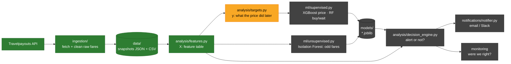
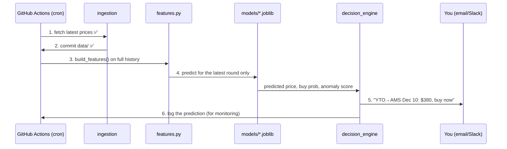

# TODO: what's built, what's left

The goal: every few hours, check flight prices and tell the user **"Buy now"** or **"Wait"**.

## 1. The big picture

🟩 done  ·  🟨 next  ·  ⬜ later

## 2. What happens on every run, once it's all built

GitHub Actions already runs steps 1–2. Steps 3–6 are what's left.

## 3. Checklist

### ✅ Done

- [x] **Ingestion:** `src/ingestion/` (API client, normalizer, multi-route fetch, CSV rebuild)
- [x] **Scheduled collection:** `.github/workflows/fetch_snapshots.yml` runs `scheduler --once` and commits `data/`
- [x] **Cleaning + features:** `src/analysis/features.py` → `build_features()` (X) and `model_matrix()` (tree / linear)

### 🟨 Next: create the answer column

- [ ] **`src/analysis/targets.py`:** `add_targets(features)` adds
  - `future_min_price`: cheapest price of the same trip in the next 7 days (for XGBoost)
  - `buy`: 1 if waiting saves less than 5% (for Random Forest)
  - only rows whose 7-day window is fully observed get a value
- [ ] **Small fix in `features.py`:** add `categories=` to `build_features()` so a saved model gets the same category codes at prediction time
- [ ] **Tests:** `tests/test_features.py` and `tests/test_targets.py` (past-only windows, future-only targets, fill rules)

### ⬜ Then: models

- [ ] **`src/ml/unsupervised.py`:** Isolation Forest on `price_vs_route_avg_30d`, `price_vs_route_min_30d`, `route_std_7d`, `days_until_departure`. Needs no `y`, so it can come before or alongside `targets.py`.
- [ ] **`src/ml/supervised.py`:**
  - split by time: train on older rounds, test on the newest ~5 days
  - price: "no change" rule → Ridge (`X_linear`) → XGBoost (`X_tree`)
  - buy/wait: "always buy" rule → Logistic Regression → Random Forest
  - keep a model only if it beats the simple rule
  - save each as `models/<name>.joblib` = `{pipeline, kind, categories, columns}`

### ⬜ Then: alerts

- [ ] **`src/analysis/decision_engine.py`:** combine three signals into one yes/no
  1. rule: price ≤ route's 30-day minimum (works today, no ML)
  2. Isolation Forest says the fare is unusually low
  3. Random Forest buy probability above a cutoff
- [ ] **`src/notifications/notifier.py`:** email or Slack webhook first. Add a cooldown so the same trip isn't alerted twice in a row.
- [ ] **Hook into GitHub Actions:** after the fetch step, run `score.py` (build features → load models → decide → notify)
  - credentials go in GitHub Secrets, not `.env`
  - `models/` must be committed (or trained inside the workflow), because Actions can't see your laptop

### ⬜ Then: monitoring

- [ ] **Log every prediction** to `data/logs/predictions.jsonl` (trip, time, predicted price, buy prob, alert sent?)
- [ ] **Check them 7 days later:** once the real `future_min_price` is known, compare it with the prediction (MAE for price, precision for "buy")
- [ ] **Retrain weekly:** a second workflow that runs `supervised.py` and commits new `models/`

### ⬜ Optional, only if needed

- [ ] `src/analysis/seasonality.py` (STL): useful after a few months of data; 3 weeks shows only the weekly cycle
- [ ] K-Means / DBSCAN route clusters as an extra feature
- [ ] Prophet / LSTM forecasts
- [ ] Database (`src/storage/`, TimescaleDB / Redis): only if the JSON/CSV files get too big for git

## 4. Where the README differs from the code

| README says | Actually |
|---|---|
| `scheduler.py` = Airflow / Celery Beat | A simple `--once` runner triggered by GitHub Actions |
| Storage = TimescaleDB + Redis | Files in `data/`, committed by the workflow |
| Cron every 6 hours | GitHub runs it about every 9 hours (delayed scheduled runs) |
| Phase 2 after ~4 weeks of data | Data starts Nov 3, 2026 → ~4 weeks around Dec 1 |
